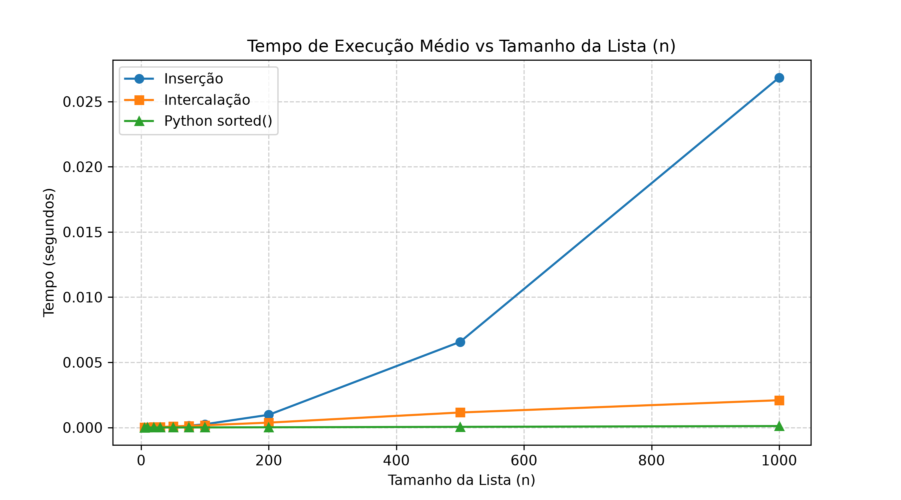
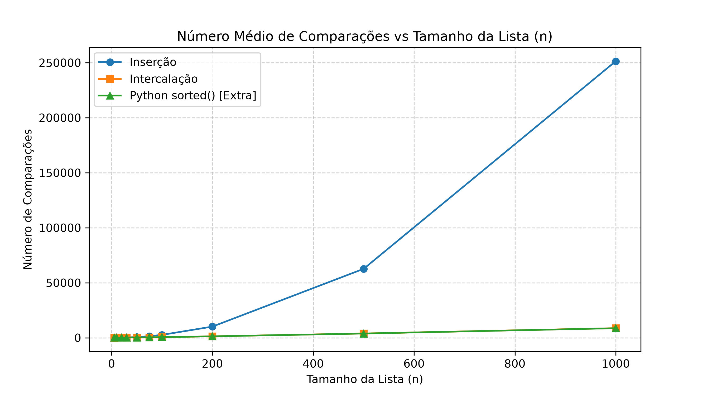

# Relatório de Análise Comparativa

## 1. Tabela de Tempos e Comparações

| n | Tempo Inserção (s) | Tempo Intercalação (s) | Tempo sorted() (s) | Comparações Inserção | Comparações Intercalação | Comparações sorted() |
|---|---|---|---|---|---|---|
| 5 | 0.00000185 | 0.00000687 | 0.00000057 | 7.33 | 7.20 | 9.27 |
| 10 | 0.00000529 | 0.00001853 | 0.00000087 | 30.53 | 23.33 | 25.20 |
| 20 | 0.00001216 | 0.00002993 | 0.00000123 | 118.13 | 64.07 | 64.40 |
| 30 | 0.00002243 | 0.00004412 | 0.00000189 | 243.20 | 111.27 | 110.47 |
| 50 | 0.00006121 | 0.00007809 | 0.00000324 | 652.53 | 222.80 | 219.47 |
| 75 | 0.00014851 | 0.00012806 | 0.00000674 | 1428.07 | 376.07 | 372.67 |
| 100 | 0.00027287 | 0.00018990 | 0.00007075 | 2617.67 | 542.27 | 535.87 |
| 200 | 0.00106536 | 0.00036967 | 0.00001913 | 10054.73 | 1279.53 | 1271.87 |
| 500 | 0.00691027 | 0.00101441 | 0.00004910 | 63259.93 | 3851.93 | 3830.07 |
| 1000 | 0.03888329 | 0.00244950 | 0.00011481 | 246995.20 | 8704.47 | 8660.13 |

---

## 2. Gráficos Gerados

### Tempo de Execução vs Tamanho da Entrada

### Número de Comparações vs Tamanho da Entrada

---

## 3. Ponto de Virada em Tempo

A intercalação passa a ser mais rápida que a inserção na faixa entre **$n = 50$ e $n = 75$**:
- Para **$n = 50$**: a Inserção levou `0.000061 s` vs Intercalação `0.000078 s` (Inserção foi mais rápida).
- Para **$n = 75$**: a Intercalação assumiu a liderança com `0.000128 s` vs Inserção `0.000149 s`.

A partir de $n = 75$, a complexidade $\mathcal{O}(n^2)$ da inserção cresce exponencialmente em tempo comparada a $\mathcal{O}(n \log n)$ da intercalação (para $n = 1000$, a inserção foi cerca de 15 vezes mais lenta).

---

## 4. Divergência entre Ponto de Virada de Tempo e de Comparações

O ponto de virada **não** ocorre no mesmo $n$:
- **Em Comparações:** Ocorre entre **$n = 5$ e $n = 10$** (em $n = 10$, a inserção faz 30.5 comparações médias contra 23.3 da intercalação).
- **Em Tempo:** Ocorre apenas entre **$n = 50$ e $n = 75$**.

### Motivo:
A contagem de comparações isola apenas uma operação relacional abstrata. A intercalação possui um custo de sobrecarga estrutural muito maior: divisão recursiva de listas (`arr[:meio]`), chamadas no call stack e alocação dinâmica de novos vetores para mesclagem. A inserção atua diretamente sobre o array original (*in-place*) sem alocação dinâmica contínua. Essa sobrecarga de chamadas e alocação em memória faz com que a intercalação precise de um $n$ consideravelmente maior para compensar seu custo temporal fixo.

---

## 5. Inadequação do `sorted()` para Decidir entre os Dois Algoritmos

A função embutida `sorted()` do Python utiliza o Timsort, cuja rotina é compilada nativamente em **linguagem C**. Em contrapartida, as implementações de inserção e intercalação deste experimento foram desenvolvidas em **Python interpretado**.

A máquina virtual CPython impõe uma sobrecarga de interpretação de bytecode, checagem dinâmica de tipos e controle de frames que não existe no binário C do `sorted()`. A diferença expressiva de ordens de grandeza no tempo reflete primariamente a disparidade entre execução nativa (C) e interpretada (Python), não servindo como critério para avaliar a eficiência algorítmica relativa dos dois métodos.

---

## 6. Caso em que a Inserção é a Escolha Adequada

A ordenação por inserção é a escolha recomendada quando os dados já estão **quase ordenados** (possuem poucas inversões) ou quando os dados são recebidos continuamente como um fluxo (*online sorting*).

Nessas circunstâncias:
- O laço interno da inserção finaliza quase imediatamente a cada iteração, atingindo complexidade de tempo linear **$\mathcal{O}(n)$**.
- O algoritmo não aloca memória auxiliar, mantendo complexidade espacial **$\mathcal{O}(1)$** (*in-place*), contra os **$\mathcal{O}(n)$** de memória extra exigidos pela intercalação.

---

## 7. Extra: Contagem de Comparações do `sorted()` e Limite de $n \log_2 n$

A contagem de comparações do `sorted()` foi obtida encapsulando os inteiros em uma classe personalizada que sobrecarrega o método especial `__lt__` (operador `<`) e incrementa um contador a cada invocação.

Para **$n = 1000$**:
- **Comparações realizadas pelo `sorted()`:** $8.660$
- **Comparações realizadas pela Intercalação:** $8.704$
- **Limite inferior teórico de árvores de decisão ($n \log_2 n$):** $1000 \times \log_2(1000) \approx 1000 \times 9.9658 \approx 9.966$ comparações.

O Timsort realizou aproximadamente **$87\%$** de $n \log_2 n$ comparações em listas aleatórias, mantendo-se estritamente abaixo do limite assintótico esperado para ordenações baseadas em comparação e confirmando a eficácia prática de suas heurísticas de galope (*galloping mode*).
